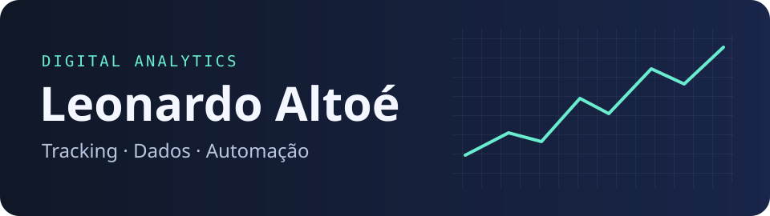

Sou Leonardo Altoé, analista sênior de Digital Analytics. Trabalho com implementação e auditoria de tracking, análise de funis e automação de dados para web, app e mídia.

## Projeto em destaque

Criei o **Ventus Tag Debugger**, uma extensão Chrome para inspecionar eventos do Data Layer e requisições de tracking em tempo real. Ela ajuda a validar implementações de GA4, GTM, Meta Ads e Google Ads.

## Ferramentas que uso

- **Mensuração** · GA4, Firebase Analytics, GTM Web e Server-Side
- **Dados** · BigQuery, SQL, Python e JavaScript
- **Visualização** · Looker Studio e Power BI
