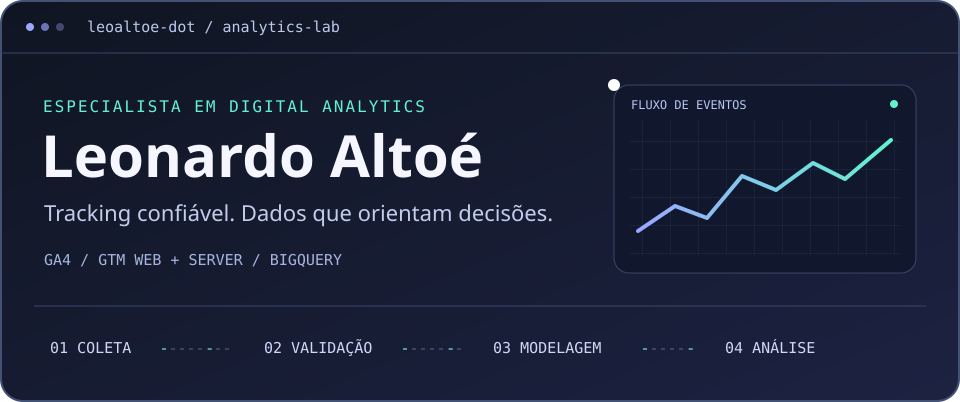

[Projeto](#projeto-em-destaque) · [Experiência](#experiência-aplicada) · [Stack](#stack) · [Como trabalho](#como-trabalho) · [Atividade](#atividade-no-github)

# Leonardo Altoé

**Especialista em Digital Analytics | Mensuração web e app | Engenharia de dados**

Trabalho com o ciclo completo de mensuração, do plano de tracking à entrega dos indicadores. Implemento e audito eventos, modelo dados no BigQuery e automatizo rotinas de análise para times de produto e mídia.

## Projeto em destaque

**Ventus Tag Debugger** é uma extensão para Chrome que desenvolvi para validar implementações de tracking em tempo real.

- Inspeciona eventos do **Data Layer** e requisições de rede durante a navegação.
- Identifica sinais de **GTM, GA4, Meta Ads e Google Ads**, incluindo integrações server-side.
- Mantém histórico de eventos para apoiar diagnóstico e homologação.

[Conheça o código e a documentação do Ventus →](https://github.com/leoaltoe-dot/ventus-tag-debugger)

## Experiência aplicada

| Frente | O que entrego |
| --- | --- |
| Mensuração web e app | Planos de eventos, funis de e-commerce, auditoria de tags, validação de parâmetros e integração entre domínios. |
| Tracking server-side | Validação de GTM server-side, implementação de Meta CAPI e revisão de Consent Mode. |
| Modelagem e atribuição | Exportação GA4 → BigQuery, normalização de origem e campanha, regras de canais e deduplicação de eventos. |
| Automação e BI | Extrações de mídia, consultas agendadas, bases para pacing e dashboards de performance. |

<strong>Ver exemplos de trabalho</strong>

- **Qualidade de dados:** confronto eventos de e-commerce com os dados da plataforma para identificar duplicidades e divergências de parâmetros.
- **Jornada de conversão:** estruturo funis por sessão para comparar web e app, da entrada à conversão.
- **Pacing de mídia:** consolido investimento, impressões, cliques e conversões no BigQuery para acompanhar orçamento e desempenho.

## Stack

**Mensuração e atribuição**  
   

**Dados e automação**  
   

**BI e mídia**  
   

## Como trabalho

1. **Planejar** · Defino eventos, parâmetros e critérios de aceite com base na pergunta de negócio.
2. **Instrumentar** · Implemento o tracking e valido os disparos, o payload e o recebimento na plataforma.
3. **Modelar** · Trato granularidade, duplicidades e atribuição no BigQuery para construir bases reutilizáveis.
4. **Analisar** · Traduzo os dados em funis, comparativos e indicadores para produto e mídia.

## Atividade no GitHub

[Repositórios públicos](https://github.com/leoaltoe-dot?tab=repositories) · [Histórico de contribuições](https://github.com/leoaltoe-dot#js-contribution-activity-description)

